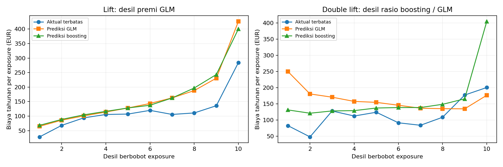

# Pemodelan Frekuensi dan Severitas Klaim Kendaraan

Saya menghubungkan frekuensi, severitas, exposure, dan biaya klaim melalui model yang dapat diperiksa.
Seluruh angka berasal dari eksekusi pipeline dan tersimpan dalam `reports/hasil.json` serta CSV.

## Audit sumber penuh

| Pemeriksaan | Hasil |
|---|---:|
| raw_policies | 678013 |
| raw_claim_rows | 26639 |
| duplicate_policy_ids | 0 |
| exact_duplicate_claim_rows | 255 |
| invalid_exposure_rows | 0 |
| exposure_above_one_rows | 1224 |
| nonpositive_claim_rows | 0 |
| missing_cells_freq | 0 |
| missing_cells_sev | 0 |
| severity_ids_absent_from_frequency | 195 |
| severity_unique_ids_absent | 6 |
| count_mismatch_policies | 9117 |
| frequency_claim_total | 36102 |
| matched_positive_claim_total | 26444 |
| positive_claim_frequency_zero_policies | 0 |

Saya melaporkan baris klaim dan ID unik yang tidak terhubung secara terpisah. Mismatch adalah
perbandingan ClaimNb dengan jumlah baris severity positif per polis sesudah agregasi.
Kamus: [docs/data_dictionary.md](../docs/data_dictionary.md); sumber dan hash di `source.json`.

## Metodologi

Saya mengaudit kedua tabel sumber penuh, lalu mengambil simple random sample
100,000 ID polis tanpa pengembalian dengan seed 2024 sebelum split 80:20.
Saya membatasi pelatihan untuk waktu dan memori lingkungan lokal; hasil ini bukan analisis
model penuh atas 678,013 polis. Sampel menghasilkan 80,000
polis latih dan 20,000 polis uji, serta 3,091 dan
800 baris klaim positif yang terhubung. Overlap ID = 0.
Semua klaim dari suatu ID mengikuti split polis tersebut. Saya tidak menstratifikasi
berdasarkan target dan tidak mengubah sampel berdasarkan hasil uji.

Saya mengagregasikan klaim positif per ID sebelum left join one-to-one ke frekuensi.
Saya menolak ID frekuensi berulang, target count noninteger/negatif, dan angka tidak hingga;
saya mengecualikan exposure <= 0 serta klaim <= 0 dengan jumlah tercatat dalam audit.
Exposure >1 tetap dipertahankan sebagai periode lebih dari satu tahun.
Baris klaim identik dipertahankan karena tidak tersedia claim ID untuk membuktikan duplikasi.
Tidak ada severity terhubung diperlakukan sebagai biaya tercatat nol, bukan bukti tidak ada
kewajiban klaim. Ketidakcocokan count tidak diperbaiki dengan menciptakan klaim.

Saya memakai Area, VehGas, Region, VehBrand sebagai faktor kategorik, serta VehPower,
VehAge, DrivAge, BonusMalus dan log(1+Density) sebagai efek numerik linier.
Saya menetapkan bentuk ini sebelum fit; ini pendekatan sederhana dan dapat melewatkan
nonlinieritas usia. Imputasi median/modus, standardisasi, dan kategori referensi dipelajari
dari polis latih saja. Kategori baru mendapat semua dummy nol dan peringatan pustaka;
prediksi demikian memakai efek referensi dan perlu ditinjau sebelum pemakaian nyata.
Kategori referensi: {"Area": "A", "VehGas": "Diesel", "Region": "R11", "VehBrand": "B1"}.

Saya memodelkan jumlah klaim Poisson dengan log-link dan offset log(exposure).
Offset nol menghasilkan frekuensi tahunan. Saya membandingkan NB2, Var(N)=mu+alpha*mu²,
dengan alpha = max(1e-6, sum((N-mu)²-mu)/sum(mu²)) dari residual Poisson latih.
Ini estimator method-of-moments plug-in, bukan joint maximum likelihood.
Pearson chi-square/df Poisson = 2.867204; alpha NB2 =
0.846232. Heterogenitas dan spesifikasi rerata juga dapat
menyebabkan overdispersi. Interval koefisien NB2 bersyarat pada alpha, tanpa ketidakpastian
estimasi alpha. AIC NB2 bawaan memperlakukan alpha tetap, sehingga saya menambahkan
penalti dua sebagai sensitivitas satu parameter tambahan; keduanya bukan bukti optimalitas MLE.

Saya mengestimasi GLM Gamma log-link pada setiap baris klaim positif, bukan rata-rata polis.
Beberapa klaim satu polis memberi beberapa baris dengan kovariat polis sama dan bobot satu
per klaim. Saya tidak membobot severity dengan exposure. Dependensi antarklaim satu polis
dapat membuat interval Wald konvensional terlalu sempit; saya tidak menafsirkannya sebagai
inferensi konfirmatori. IRLS langsung tidak stabil untuk target tanpa batas pada data asli.
Saya meminimumkan objective koefisien Gamma log-link yang konveks, mean(eta + y_scaled*exp(-eta)),
melalui trust-exact setelah membagi target dengan rerata latih. Saya mengembalikan skala
intersep, kemudian menjalankan IRLS statsmodels dari optimum tersebut untuk inferensi.
Saya mewajibkan gradien maksimum <=1e-6 dan konvergensi IRLS; diagnostik lengkap tersimpan
di `gamma_optimization` pada hasil.json. Saya tidak mengganti target atau memakai data uji
untuk mengatasi kegagalan numerik tersebut.
Saya melatih dua target terpisah: nilai klaim dibatasi di kuantil 99%
latih (18056.02 EUR) dan nilai klaim asli tanpa batas. Kuantil tidak memakai
klaim uji. Saya juga menyajikan sensitivitas biaya terhadap q95, q99, maksimum latih, dan
tanpa batas. Hanya q99 dan tanpa batas memiliki model Gamma tersendiri; q95 merupakan
sensitivitas target, bukan hasil model yang dilatih ulang.

Premi murni tahunan = frekuensi tahunan × severitas per klaim. Biaya periode = premi murni
× exposure. Target terbatas berbeda dari target tanpa batas dan bukan estimasi cadangan
atau tarif komersial. Pembanding HistGradientBoosting memakai Poisson loss pada ClaimNb/Exposure
dengan sample_weight=Exposure, preprocessing fit pada latih dan 100 iterasi tetap tanpa
early stopping. Saya memakai Gamma q99 yang sama untuk kedua prediksi biaya agar perbedaan
berasal dari frekuensi. Poisson GLM ditetapkan sebagai model utama sebelum evaluasi,
bukan dipilih berdasarkan data uji.

## Definisi evaluasi dan relativitas

Saya mengevaluasi frekuensi dengan mean Poisson deviance pada count periode
di polis uji yang sama. Saya juga melaporkan deviance rate berbobot exposure, yang memiliki
normalisasi berbeda; ini tidak boleh dianggap angka identik dengan deviance count.
Deviance NB2 juga dihitung untuk ketiga prediksi dengan alpha latih yang sama agar
perbandingan tetap memakai satu aturan penilaian. Ini bukan estimasi ulang alpha pada uji.
Gamma deviance dihitung per klaim uji positif untuk target yang sesuai. AIC frekuensi
dibandingkan hanya pada respons count dan sampel latih yang sama. AIC Gamma terbatas dan
tanpa batas dilaporkan terpisah, tidak diperingkatkan karena target berbeda. AIC tidak
dibandingkan lintas frekuensi/severitas atau terhadap boosting.

Saya membentuk desil dari akumulasi exposure sesudah mengurutkan premi murni GLM dari
rendah ke tinggi. Setiap polis utuh ditempatkan menurut titik tengah exposure sehingga
batas tidak memecah polis dan exposure tiap desil mendekati 10%. Aktual dan prediksi per
desil adalah jumlah biaya dibagi jumlah exposure, bukan rerata rate polis tanpa bobot.
Lift aktual = rate biaya desil / rate biaya seluruh sampel uji. Double lift mengurutkan
rasio prediksi biaya boosting/GLM, lalu membuat desil exposure dengan cara yang sama dan
menampilkan kedua prediksi serta aktual. Grafik double lift membantu melihat area
ketidaksepakatan model, bukan bukti kausal atau pengganti validasi eksternal.

Pada tabel relativitas, exp(beta) faktor adalah pengali terhadap kategori referensi dengan
kovariat lain tetap. Efek numerik adalah pengali untuk kenaikan satu simpangan baku latih,
bukan satu tahun/satu unit mentah. `numeric_sd_train` dalam hasil.json menyimpan konversinya;
relativitas satu unit mentah = exp(beta/sd). Intersep adalah rate/severity pada kategori
referensi dan numerik terstandar nol, bukan pengali tarif. Interval adalah Wald 95% bersyarat
spesifikasi. Standardisasi dan referensi dipakai ulang pada uji tanpa fit ulang.

## Hasil uji dan AIC latih

| model             |   test_count_poisson_deviance |   test_nb2_deviance_at_train_alpha |   test_exposure_weighted_rate_deviance |   actual_claims |   predicted_claims |   count_calibration_ratio |
|:------------------|------------------------------:|-----------------------------------:|---------------------------------------:|----------------:|-------------------:|--------------------------:|
| Poisson GLM       |                      0.334928 |                           0.296648 |                               0.633153 |            1114 |            1073.58 |                  0.963716 |
| NB2 GLM           |                      0.334934 |                           0.29663  |                               0.633165 |            1114 |            1085.41 |                  0.974332 |
| Gradient boosting |                      0.319576 |                           0.281785 |                               0.604132 |            1114 |            1077.31 |                  0.967064 |

| target    |   test_claim_rows |   gamma_deviance |   actual_mean |   predicted_mean |   train_aic |
|:----------|------------------:|-----------------:|--------------:|-----------------:|------------:|
| limited   |               800 |          1.05377 |       1533.49 |          1630.05 |     52987.7 |
| unlimited |               800 |          1.3971  |       1654.38 |          2342.04 |     62790   |

Total exposure uji = 10579.6686 tahun polis.
Biaya terbatas aktual = EUR 1,226,790.73; prediksi GLM =
EUR 1,740,362.67; prediksi boosting =
EUR 1,741,332.45.
Rasio prediksi biaya GLM/aktual terbatas = 1.4186,
sehingga total biaya belum terkalibrasi baik. Salah satu keterbatasan penting adalah
target frekuensi ClaimNb tidak selalu cocok dengan jumlah severity yang tercatat.
Biaya tanpa batas aktual = EUR 1,323,503.02; prediksi GLM =
EUR 2,484,115.56.
Pembatasan menghilangkan EUR 2,598,338.10 pada latih dan
EUR 96,712.29 pada uji. Perbedaan total target ini harus
dipertimbangkan ketika menilai kalibrasi. Semua GLM konvergen: True.

AIC Poisson latih = 33739.491; AIC NB2 alpha tetap =
33632.137; sensitivitas penalti alpha =
33634.137.

## Aktual versus prediksi dan lift

|   decile |   policies |   exposure |   actual_annual_cost |   actual_lift |   period_cost |   boost_period_cost |
|---------:|-----------:|-----------:|---------------------:|--------------:|--------------:|--------------------:|
|        1 |       1669 |    1058.2  |              28.3398 |      0.244398 |       64.7515 |             68.1797 |
|        2 |       1646 |    1057.6  |              67.9759 |      0.586214 |       85.9331 |             88.5168 |
|        3 |       1685 |    1058.27 |              93.9343 |      0.810076 |      100.758  |            104.24   |
|        4 |       1728 |    1057.68 |             105.608  |      0.910751 |      114.058  |            116.336  |
|        5 |       1729 |    1058.43 |             107.034  |      0.923044 |      128.034  |            128.048  |
|        6 |       1855 |    1057.67 |             119.79   |      1.03305  |      143.506  |            137.417  |
|        7 |       2098 |    1058.33 |             105.747  |      0.911943 |      162.859  |            162.575  |
|        8 |       2319 |    1057.24 |             110.884  |      0.956248 |      187.934  |            196.865  |
|        9 |       2554 |    1058.61 |             135.758  |      1.17076  |      230.67   |            243.325  |
|       10 |       2717 |    1057.62 |             284.558  |      2.45399  |      426.575  |            400.481  |

## Double lift

|   decile |   policies |   exposure |   actual_annual_cost |   actual_lift |   period_cost |   boost_period_cost |
|---------:|-----------:|-----------:|---------------------:|--------------:|--------------:|--------------------:|
|        1 |       2336 |    1058.22 |              82.9298 |      0.715175 |       250.284 |             131.53  |
|        2 |       2059 |    1057.96 |              48.1857 |      0.415546 |       180.972 |             121.36  |
|        3 |       1960 |    1058.19 |             128.246  |      1.10598  |       170.935 |             128.403 |
|        4 |       1922 |    1057.08 |             112.737  |      0.972225 |       157.874 |             129.37  |
|        5 |       1826 |    1058.29 |             124.372  |      1.07257  |       154.939 |             137.442 |
|        6 |       1819 |    1058.12 |              91.7662 |      0.791379 |       146.009 |             138.872 |
|        7 |       1801 |    1058.26 |              84.0896 |      0.725177 |       136.851 |             138.992 |
|        8 |       1853 |    1057.14 |             108.896  |      0.939105 |       135.37  |             148.859 |
|        9 |       1943 |    1058.7  |             177.497  |      1.53071  |       134.939 |             165.869 |
|       10 |       2481 |    1057.7  |             200.84   |      1.73202  |       176.822 |             405.279 |

## Sensitivitas klaim ekstrem

| train_quantile   |     train_limit |   train_claims_above |   test_claims_above |   test_total_limited_cost |
|:-----------------|----------------:|---------------------:|--------------------:|--------------------------:|
| 0.95             |  4820.32        |                  155 |                  38 |               1.05503e+06 |
| 0.99             | 18056           |                   31 |                   6 |               1.22679e+06 |
| 1.0              |     1.40306e+06 |                    0 |                   0 |               1.3235e+06  |
| unlimited        |   nan           |                    0 |                   0 |               1.3235e+06  |

Tabel relativitas seluruh koefisien, kategori referensi, dan interval: `relativities.csv`.
EDA berbobot exposure per faktor: `eda_rates.csv`. Prediksi per polis: `test_predictions.csv`.

## Keterbatasan

Saya memakai data historis motor third-party liability Prancis yang tidak otomatis
mewakili pasar Indonesia. Sumber frekuensi dan severitas memiliki ketidakcocokan ID/count;
produk frekuensi × severity mengasumsikan keterkaitan target dan proses klaim yang belum
sepenuhnya terverifikasi. Evaluasi biaya memakai pembayaran positif yang tercatat, tidak
mencakup klaim hilang, inflasi, perkembangan klaim, deductible, limit kontrak, biaya akuisisi,
margin, pajak, reasuransi, atau perubahan exposure mendatang. Saya tidak mengoreksi perbedaan
count secara spekulatif. Tail berat dan sedikit klaim pada desil tertentu membuat kurva
biaya tidak stabil. Korelasi fitur, efek numerik linier, dan ketergantungan klaim membatasi
interpretasi serta interval. Split acak tunggal belum menguji generalisasi antarwaktu.
Saya hanya melatih sampel polis yang didokumentasikan; audit skema dan kualitas menggunakan
data sumber penuh. Studi ini merupakan portofolio dan belum menjadi tarif siap pakai
untuk perusahaan asuransi.

